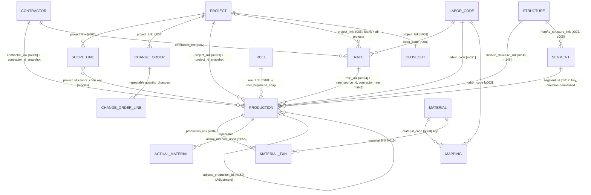

# Relationship Map

Handoff section 6. Every relationship below was read from the committed
schemas (`fulcrum/schemas/`), which `scripts/config_snapshot.py` checks against
live. Field keys are in brackets. Full field lists are in
`docs/field-dictionary.md`.

A relationship is held in one of three ways, and the difference matters:

| Kind | What it stores | Survives the target being deleted? |
|---|---|---|
| **Link**: a Fulcrum record link | The target's `_record_id` | **No.** The link points at nothing. That is why every money-relevant link is also snapshotted |
| **Snapshot**: a copy of the target's business key or values, taken when linked | `project_id_snapshot`, `rate_source_id`, `contractor_rate`… | **Yes.** It is the historical record (D-003) |
| **Key**: a business key matched by a report | `project_id` + `labor_code`, `segment_id`, `material_code` | Yes. A report joins on the key at run time |

`LABOR_CODE` is the **MC Labor Code** choice list, not an app.

---

## The seven chains the brief names

### 1. Project → Project Scope → Production
- **Project → Scope line:** link `project_link` [s002]. One line per
  project + labor code (+ phase). A line is authorized scope only when
  BASELINED or CLOSED.
- **Project → Change order → lines:** link `project_link` [o003]. Each line is a signed
  delta per labor code, `line_labor_code` [o015]. Authorized scope = baseline + APPROVED change
  orders.
- **Scope → Production:** **key**, project + labor code, matched by
  `project-scope-status`, `remaining-work` and `unplanned-production`.
  Production has no link to a scope line: field users never choose one, and
  reports match on the key at run time.

### 2. Production → Contractor, Labor Code, Rate, Structure/Segment, Fiber Reel

| To | How | Field(s) | Notes |
|---|---|---|---|
| Contractor | link + snapshot | `contractor_link` [m080], `contractor_id_snapshot` | |
| Labor code | choice | `labor_code` [m021] | `unit` [m024] is copied from the rate; description from the rate |
| Rate | link + snapshot | `rate_link` [m074] → `rate_source_id`, `contractor_rate` [m043], `rate_labor_code_snap`, `rate_contractor_id_snap`, `rate_effective_date` | The price is frozen on the record (D-003). `extended_value` [m046] = quantity × snapshotted rate |
| Structure | link + snapshot | `from_structure_link` [m145], `to_structure_link` [m146], `*_id_snap`, `*_type_snap` | |
| Segment | key, derived | `segment_id` [m017], built on the device from the two structure IDs, sorted | Matches MC Segment `segment_id` [z001]; `segment-integrity.sql` checks it |
| Fiber reel | link + snapshot | `reel_link` [m081], `reel_id`, `reel_begin_snap`, `reel_end_snap` | Consumption is computed by `reel-balance.sql`, never stored (D-012) |

### 3. Labor Code → Labor-Material Mapping → Material
- **Mapping → labor code:** `labor_code` [g002]. **Mapping → material:**
  `material_code` [g003], a **key** into MC Material Master (`material_code` [t001]).
- Only APPROVED, active mappings count (`bridge_labor_material.is_usable`).
- Mappings are superseded (`supersedes_mapping_id`), never edited.

### 4. Production → Material Transactions
- **Ledger rows:** MC Material Transaction links production
  (`production_link` [x004], `production_id_snap`) and material
  (`material_link` [x010], `material_code_snap`). Each row is one atomic
  movement, and balances are never stored.
- **Crew-reported consumption:** the repeatable `actual_material_used` [m055]
  on production.
- **Expected consumption:** computed by `material-variance.sql` from the
  approved mappings. Conduit is the exception: it is computed on the device
  as `conduit_material_code` / `conduit_material_quantity`.

### 5. Project → Change Orders
Link `project_link` [o003], plus `contractor_link` [o006]. Lines are signed
deltas, so a change order is never rewritten. The record status gives the
approval: APPROVED counts, REJECTED and CANCELLED do not.

### 6. Production → QA / Approval
QA lives **on** the production record:
- `qa_status` [m057], `qa_owner` [m154], `qa_due_date`, `correction_completed`
- the workflow stamps: submitted, reviewed, approved (`approved_by` [m067]), reopened and
  reversed

The status lifecycle is in handoff §15–16. An Adjustment record names the
production it corrects in `adjusts_production_id` [m152], and
`production_type` [m151] marks it as an Adjustment.

### 7. Production → Reporting / Financials
Reports read the snapshots, never the live master. A rate edited tomorrow
changes no report about yesterday. Only APPROVED production is official
(rule 1). Quantities are summed only within one unit (rule 2).

| Question | Report |
|---|---|
| What was produced | `production-daily/weekly/monthly`, `production-dashboard` |
| What is owed | `contractor-financial`, `project-financial`, `invoice-reconciliation-basis` |
| What is left | `remaining-work`, `forecast-completion` |
| What is wrong | `exception-dashboard`, `audit-*`, `data-quality-scorecard` |
| Downstream feeds | `integration-export-production`, `reports/bi/` |

Full list: `docs/report-inventory.md`.

---

## Keys that must stay unique

`reports/integration-id-integrity.sql` checks these. It ran live on
2026-11-12 with every key passing.

| Key | App | Format |
|---|---|---|
| `production_id` | Production | `PRD-<year>-<8 chars of record id>` |
| `project_id` | Project | `PRJ-000001` |
| `contractor_id` | Contractor | `CON-0001` |
| `rate_id` | Rate | `RATE-000084` |
| `material_code` | Material | part number |
| `mapping_id` | Mapping | `MAP-000131` |
| `scope_line_id`, `transaction_id`, `structure_id`, `segment_id` + `segment_type`, `reel_id`, `closeout_id` | | derived or entered |
