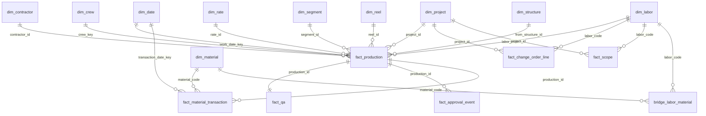

# Sprint 29 — Power BI / External Analytics Readiness

**Date:** 2026-11-12. **17 datasets built in `reports/bi/`; all 17 run against
live data.** No Power BI workspace has been created or connected: that is an
integration, and the brief says to prepare, not build.

> *"Keep transaction-level authoritative quantity, rate, extended value,
> sequential footage, material usage, and approval status in Fulcrum. Power BI
> should primarily aggregate and analyze. Do not calculate contractor rates
> independently in both systems."*

## 1. The star schema



| Brief | Built as | Grain | Key |
|---|---|---|---|
| **Fact: Production** | `fact_production` | production record | `production_id` |
| **Fact: Material** | `fact_material_transaction` | ledger row | `transaction_id` |
| **Fact: Change Orders** | `fact_change_order_line` | change-order line | `change_order_line_key` |
| **Fact: QA** | `fact_qa` | production record (QA view) | `production_id` |
| Dim: Project | `dim_project` | project | `project_id` |
| Dim: Contractor | `dim_contractor` | contractor | `contractor_id` |
| Dim: Labor | `dim_labor` | pay unit, **with its unit** | `labor_code` |
| Dim: Material | `dim_material` | stock item | `material_code` |
| Dim: Date | `dim_date` | calendar day | `date_key` (YYYYMMDD) |
| Dim: Structure | `dim_structure` | structure | `structure_id` |
| Dim: Crew | `dim_crew` | contractor + crew | `crew_key` |

The other datasets the brief lists:

| Dataset | Built as | Note |
|---|---|---|
| Rates | `dim_rate` | Every rate version. **Reference only.** See §3 |
| Mappings | `bridge_labor_material` | labor ↔ material, with multiplier and waste factor kept apart |
| Scope | `fact_scope` | the plan; `is_authorized` = BASELINED/CLOSED |
| Segments | `dim_segment` | direction-normalized `segment_id` joins production |
| Fiber Reels | `dim_reel` | printed range and waste only; consumption is summed from production |
| Approvals | `fact_approval_event` | one row per workflow stamp, for turnaround and volume over time |

**Live row counts, 2026-11-12:**

| Rows | Datasets |
|---|---|
| 146 | dim_rate, dim_labor |
| 135 | dim_material |
| 125 | bridge_labor_material |
| 1,096 | dim_date (2026–2028) |
| 3 | dim_project, dim_contractor |
| 2 | fact_production, fact_qa |
| 1 | dim_crew, fact_approval_event |
| 0 | the reel, structure, segment, scope, change-order and material-ledger datasets |

## 2. Keys

- **Business keys are the join keys**: `production_id`, `project_id`,
  `contractor_id`, `labor_code`, `material_code`, `rate_id`, `structure_id`,
  `reel_id`. They are stable by construction:
  - the Production ID is set once and never regenerated;
  - structure and segment IDs lock and are normalized;
  - rates are versioned, never overwritten.
- **`fulcrum_record_id`** (the platform's `_record_id`) is exported alongside,
  as the technical key for tracing a row back to the app.
- **`date_key`** is an integer `YYYYMMDD` in every fact. `dim_date.work_week`
  is the ISO week in the record's own format. A test runs the shipped Data
  Event's `isoWeek()` and checks it against dim_date's SQL at the year
  boundary (`TEST-BI-009`), so a week slicer cannot split.
- **`crew_key`** = `contractor_id|UPPER(TRIM(crew))`, built identically in all
  three datasets that carry it (`TEST-BI-007`). Crew is free text with no
  master: if names drift in the field, the fix is a crew master, not Power BI.
- **`segment_key`** = `segment_id|segment_type`: one physical path carries
  several types.

## 3. What stays in Fulcrum, and what Power BI may do

| Fulcrum computes (authoritative) | Power BI does |
|---|---|
| quantity, unit, rate applied (snapshot), extended value | `SUM`, `COUNT`, `AVERAGE` of those columns |
| sequential, slack and installed footage | sums, per unit |
| conduit material quantity (pull-count rule) | sums |
| status → `is_official`, `official_value`, `pending_value` | filter on the flags; never re-derive from `record_status` |
| authorized scope flags | sum `planned_quantity` where `is_authorized = 1`, plus approved change-order deltas |

**Power BI must never:**
1. Multiply a quantity by a rate. The rate is already applied, once, in
   Fulcrum. `dim_rate` exists for audit and for "what is the current price"
   questions, not for pricing production. `TEST-BI-001` refuses any dataset
   that multiplies.
2. Sum `quantity` without a unit or labor-code filter. Feet, each, splices and
   hours do not add.
3. Decide what counts. Use `is_official` and `is_pending`; they apply the same
   rules as every Fulcrum report.

### Starter measures (DAX)

```
Approved Value  = SUM(fact_production[official_value])
Pending Value   = SUM(fact_production[pending_value])
Approved Qty    = SUM(fact_production[official_quantity])      -- use only with a unit / labor_code filter
Authorized Qty  = CALCULATE(SUM(fact_scope[planned_quantity]), fact_scope[is_authorized] = 1)
                  + CALCULATE(SUM(fact_change_order_line[quantity_change]), fact_change_order_line[is_authorized] = 1)
Open QA         = SUM(fact_qa[deficiency_open])
Avg Turnaround  = AVERAGEX(FILTER(fact_approval_event, [event] = "APPROVED"), [days_from_submission])
```

## 4. Refresh

- **Source:** the Fulcrum Query API. Each dataset is one SQL file. Power BI's
  Web connector posts the SQL and reads JSON or CSV. Use a token stored in
  the Power BI gateway or service, **never in a file or a report**: OI-01 is what a
  leaked token costs.
- **Frequency:**
  - Facts: daily overnight. Fulcrum is the operational system, and a dashboard
    an hour old is fine.
  - Dimensions: weekly.
  - `dim_date`: yearly, after extending `p_to`.
- **Size:** each dataset is well under the Query API request limit (the largest
  is about 2.2 KB of SQL). Response size grows with records: past roughly 100k
  production rows, add an incremental refresh on `last_changed_at`.
- **Test data:** `dim_project.is_test_project` flags MCP-TEST-001. Filter it
  out of every production report page.

## 5. Security

- **Row-level security by contractor**, if contractors are ever given access:
  `dim_contractor[contractor_id] = USERPRINCIPALNAME()` mapping, held in Power BI.
- **No personal data beyond names:** contractor phone numbers and emails are not
  exported (`TEST-BI-008`). The approver's name is exported in
  `fact_approval_event`, because approval accountability needs it.

## 6. Fiscal periods

`dim_date.p_fiscal_start_month` is **1 (calendar year)** until the business
states its fiscal year. Change one number to set it. Tested 2026-11-12 with
a July start: 30 June 2026 is FY2026 period 12, and 1 July 2026 is FY2027
period 1, quarter 1.

## 7. Hand-off

Ready for whoever builds the Power BI model:
1. Create the 17 queries from `reports/bi/`.
2. Build the relationships in §1, single-direction from each dimension to the facts.
3. Add the measures in §3.
4. Exclude the test project.

The only decision outstanding is the fiscal year start.
